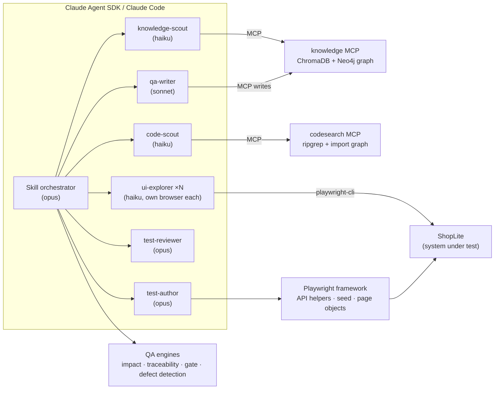

# agentic-qa

[](https://github.com/hoanglan9569/agentic-qa/actions/workflows/ci.yml)
[](https://hoanglan9569.github.io/agentic-qa/)

**AI agents that do the QA job end to end.** They plan from risk, refine
acceptance criteria, generate API and UI tests, explore the UI, report defects,
run impact-based regression and make a Go/No-Go call. The agents ground
themselves in a Hybrid RAG knowledge base and a real Playwright framework, and
deterministic engines plus human review check their work.

It runs against **ShopLite**, a small shop with a REST API and a web UI that
ships inside the repo. Everything runs locally and in CI, with no external
system. The shop also has switchable **seeded defects**, so the claim that
"the tests and agents catch bugs" can be measured.

**Stack:** Claude Agent SDK · Claude Code skills and subagents · MCP · Playwright + TypeScript on Bun ·
ChromaDB + Neo4j (Hybrid RAG, Python/uv) · LangSmith · ripgrep · GitHub Actions · Azure Pipelines

## What it does

| QA activity | Workflow (`/skill` in Claude Code, `bun run agent <name>` headless) | Backed by |
| --- | --- | --- |
| Risk-based test planning | `qa-plan` — impacted areas ranked by risk, coverage, exit criteria | `qa/impact.ts`, vault, code graph |
| AC refinement | `refine-ac CARD-142` — ambiguities, rule conflicts, Given/When/Then, questions for Product | knowledge MCP · [example](docs/examples/refine-ac-CARD-142.md) |
| Endpoint API tests | `api-testgen "PATCH /api/cart/items/:productId"` — positive + negative per endpoint | API helpers, `seed`, rule boundaries |
| API journey tests | `api-journey-testgen "two customers race for the last units"` — chained calls, final business state | `tests/api/journeys/` |
| Post-dev UI QA | `ui-qa FEAT-CART` — explore in parallel sessions, defects, manual cases, then Playwright specs | `playwright-cli`, page objects |
| Ad hoc testing | `adhoc-test "<charter>" [--defects]` — unscripted, evidence, minimal repro | `seed:session`, `playwright-cli` |
| Impact-based regression | `regression --base origin/main` — select, run, triage flaky / test defect / product bug | `qa/impact.ts` · [example](docs/examples/impact-pricing-change.md) |
| Go/No-Go | `release-gate` — blockers, residual risks, sign-off | `qa/release-gate.ts` · [example](docs/examples/release-gate.md) |
| Learning loop | `learn <PR#>` — review comments become vault learnings future runs follow | `add_learning` |



## Quick start

Prerequisites: [Bun](https://bun.sh) 1.4+ and [uv](https://docs.astral.sh/uv/). Everything else installs into the repo.

```powershell
bun run setup            # packages, browsers, Python env, RAG index
bun run test             # API + Chromium: 108 tests, starts ShopLite itself
bun run app              # ShopLite on http://localhost:3100 (SHOPLITE_DEFECTS=all for the buggy build)
```

| Command | Does |
| --- | --- |
| `bun run test:all` / `test:smoke` / `test:unit` | All browsers / critical path / QA-engine unit tests |
| `bun run qa:impact [--base <ref> \| --files <paths>]` | Change → impacted features, risk, the `--grep` to run |
| `bun run qa:trace` | Feature/rule ↔ tests ↔ manual cases ↔ defects |
| `bun run qa:gate` | Go/No-Go from `out/results.json` |
| `bun run qa:defects` | Runs the suite once per seeded defect; fails if one survives |
| `bun run rag:build` / `rag:eval` / `rag:serve` | Index the vault / evaluate retrieval / MCP over HTTP |
| `bun run codesearch "apply coupon"` | Hybrid code search (also `--symbol`, `--related`, `--helpers`) |
| `bun run seed:session --name s1 --cart 2` | Seed data over the API + a signed-in state for `playwright-cli` |
| `bun run agent <workflow> [args]` | Run a workflow headless (`bun run agent list`) |

Agents need Claude credentials: a Claude Code login locally, or `ANTHROPIC_API_KEY` / `CLAUDE_CODE_OAUTH_TOKEN`
in CI. Interactively, open the repo in Claude Code and type `/refine-ac CARD-142`.

## How it works

### Agents: orchestration, isolation, model routing

Each workflow is a **skill** (`.claude/skills/*/SKILL.md`). The skill coordinates and hands the work to **subagents**
(`.claude/agents/*.md`). Each subagent has its own context window and only the tools it needs:

| Subagent | Model | Does |
| --- | --- | --- |
| `knowledge-scout` | haiku | Business facts with document ids, from the knowledge MCP |
| `code-scout` | haiku | Existing helpers, page objects and fixtures to reuse |
| `ui-explorer` | haiku | Drives its own headless `playwright-cli` session, records labels, network calls, evidence |
| `test-author` | opus | Writes specs and page objects, validates with a focused run, typecheck and lint |
| `test-reviewer` | opus | Read-only verdict, PASS / NEEDS_REVISION, at most 2 revision rounds |
| `qa-writer` | sonnet | Manual test cases and defect reports, written into the vault |

Lookups and browser exploration run on the light model. Orchestration, authoring and review run on the strongest.
Independent explorers run in parallel, each with its own seeded data and browser session. Project rules live in
`CLAUDE.md` and `.claude/rules/`.

`agents/run.ts` runs the same skills headless through the **Claude Agent SDK**. It sets a spend cap, a turn cap and
pre-approved tools (anything else is denied), takes a JSON-schema result CI can act on, and saves a transcript plus
cost and per-model usage to `out/agent-runs/<id>/`. A real run of `refine-ac CARD-142`: [output](docs/examples/refine-ac-CARD-142.md),
[run summary](docs/examples/refine-ac-CARD-142.run.md).

### Hybrid RAG: the knowledge vault

`knowledge/` holds the business knowledge as Markdown with frontmatter and `[[links]]`: feature cards, business
rules, work-item cards, defects, manual test cases and review learnings. `rag/` indexes it two ways:

- **Vector:** chunks by section, embedded locally (all-MiniLM-L6-v2) into **ChromaDB**.
- **Knowledge graph:** documents, code files, endpoints and spec files, linked by typed edges: `GOVERNED_BY`,
  `PART_OF`, `COVERS`, `IMPLEMENTED_IN`, `EXPOSES`, `VERIFIES` (from test tags) and `LINKS_TO`. It lives in **Neo4j**
  when `NEO4J_URI` is set, otherwise in memory.
- **Hybrid search:** vector hits, graph neighbours of the ids the query names and of the top hits, and query intent,
  fused with reciprocal-rank fusion.

On a 22-question golden set (`rag/golden.yaml`), `bun run rag:eval` compares the three modes, and CI fails if hybrid
regresses. With `LANGSMITH_API_KEY` set, the run is logged to **LangSmith** as an experiment, and `--answers` adds
answer quality: Claude answers from the retrieved context only, and an LLM judge scores faithfulness.

| Mode | hit@1 | hit@5 | MRR |
| --- | --- | --- | --- |
| vector | 0.591 | 1.0 | 0.769 |
| graph | 0.455 | 0.727 | 0.577 |
| **hybrid** | **0.727** | **1.0** | **0.845** |

The **knowledge MCP server** (`rag/server.py`) exposes `search_knowledge`, `get_document`, `related`,
`list_documents`, `upsert_document` and `add_learning`. Every write re-indexes in the same call. It runs over stdio for
agents, or as a shared HTTP endpoint other teams' AI tools connect to:

```bash
docker compose up --build        # MCP at http://localhost:8765/mcp, with Neo4j

# Azure Container Apps
az acr build -r <acr> -t knowledge-mcp:1 -f rag/Dockerfile .
az containerapp create -n knowledge-mcp -g <rg> --environment <env> \
  --image <acr>.azurecr.io/knowledge-mcp:1 --registry-server <acr>.azurecr.io \
  --ingress external --target-port 8765 --secrets neo4j-password=<pw> \
  --env-vars NEO4J_URI=<bolt-uri> NEO4J_PASSWORD=secretref:neo4j-password MCP_ALLOWED_HOSTS=<app-fqdn>
```

The endpoint has no auth of its own. Keep it on an internal network, or turn on Container Apps authentication
(Entra ID) in front of it.

### Hybrid code search

The `codesearch` MCP (`codesearch/`) combines **ripgrep** text hits, ranked by term rarity, with an **import and
symbol graph** that resolves tsconfig aliases and indexes page-object methods. `list_helpers` shows agents the
reusable API helpers, `seed` and page objects before they write anything new.

### Deterministic QA engines (`qa/`)

The agents call these engines instead of deciding by feel. All of them are unit-tested.

- **Impact analysis.** A changed file maps to features through feature cards (`code:`) and reverse imports up to 3 hops.
  A changed rule maps to its feature. A framework change maps to the specs that use its classes, fixtures or
  properties. Risk = criticality × impact weight × change size × open defects. The output is the `--grep` CI runs on
  pull requests.
- **Traceability.** Each feature and rule is matched to its tagged tests, manual cases and open defects, and untested
  rules are flagged.
- **Release gate.** NO-GO on a failure in a critical area, an open critical or high defect, an untested critical rule,
  or a pass rate under 95 %. CONDITIONAL GO when only residual risks remain, each listed with its mitigation.
  Otherwise GO.
- **Seeded-defect detection.** Mutation-style: ShopLite starts once per seeded defect, the suite runs against it, and
  a test tagged with the broken rule must fail. [4 of 4 defects caught](docs/examples/defect-detection.md).

### Playwright framework

- **Setup over the API, assert at the surface.** `seed.product({ priceCents, stock })`, `seed.cart`, `seed.order` and
  `seed.shipped` create data each test owns, so all 108 tests run fully parallel.
- **Validated contracts.** ArkType schemas check every response. `expectRefused(call, status, code)` asserts the error
  contract.
- **Page objects wait for the request behind an action,** never for time. Locators are role and label based.
- **Tags drive everything.** `@FEAT-…`, `@BR-…` and `@DEF-…` feed traceability, impact selection and the gate.
  Known bugs run as `test.fail()` (DEF-001).

### CI/CD

| Pipeline | Runs |
| --- | --- |
| [QA pipeline](.github/workflows/ci.yml) | Lint, types, format and unit tests · RAG build + eval (local graph and Neo4j service) · impact selection on PRs · API, Chromium ×2 shards, Firefox and WebKit in the Playwright image · seeded-defect detection · merged report → traceability → Go/No-Go → GitHub Pages |
| [Agentic QA](.github/workflows/agentic-qa.yml) | On demand, any workflow. On a PR labelled `agentic-qa`: a test plan, then regression, with the summary posted on the PR. Workflows that write open a PR with the result. |
| [azure-pipelines.yml](azure-pipelines.yml) | The same on Azure DevOps: parallel regression published to Test Runs, the gate, and the Agent SDK regression stage |

## Project structure

```
├─ app/                 ShopLite: REST API (domain/, routes/), SPA (web/), seeded defects (defects.ts)
├─ framework/           API helpers + ArkType schemas, seed (test data), page objects, fixtures, seed:session CLI
├─ tests/               api/endpoints · api/journeys · ui · unit (QA engines)
├─ knowledge/           vault: product, features, rules, cards, defects, test-cases, learnings
├─ rag/                 Hybrid RAG (Python/uv): vault loader, ChromaDB, graph (local/Neo4j), fusion, MCP server, eval, Dockerfile
├─ codesearch/          ripgrep + import/symbol graph, CLI and MCP server
├─ qa/                  impact · traceability · release gate · seeded-defect detection
├─ agents/              Claude Agent SDK runner and workflow registry
├─ .claude/             skills/ (9 workflows) · agents/ (6 subagents) · rules/ · settings.json
├─ docs/examples/       outputs of real runs
├─ scripts/             GitHub Pages landing page
├─ .github/             CI workflows, setup action
├─ azure-pipelines.yml  Azure DevOps pipeline
├─ docker-compose.yml   knowledge MCP + Neo4j
├─ .mcp.json            knowledge + codesearch MCP servers for Claude Code
├─ CLAUDE.md            rules every agent follows
└─ playwright.config.ts projects api · chromium · firefox · webkit; starts ShopLite
```

Generated and gitignored: `out/` (reports, plans, agent runs), `.rag/` (index), Playwright output.

## License

[MIT](LICENSE) © Lan Hoang
