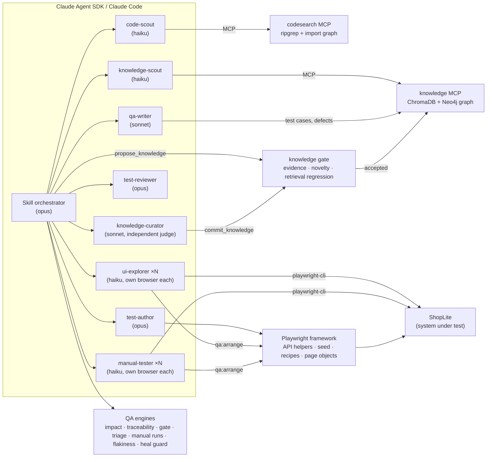
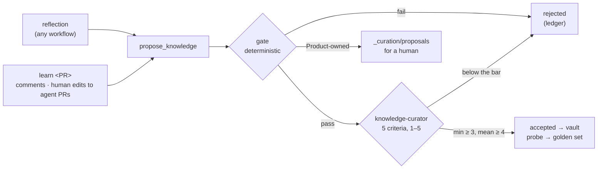

# agentic-qa

[](https://github.com/hoanglan9569/agentic-qa/actions/workflows/ci.yml)
[](https://hoanglan9569.github.io/agentic-qa/)

**AI agents that do the QA job end to end.** They plan from risk, refine
acceptance criteria, generate API and UI tests, explore the UI, report defects,
run impact-based regression and make a Go/No-Go call. The agents ground
themselves in a Hybrid RAG knowledge base and a real Playwright framework, and
deterministic engines plus human review check their work.

It runs against **ShopLite**, a small shop with a REST API and a web UI that
ships inside the repo. Everything runs locally and in CI, with no external
system. The shop also has switchable **seeded defects**, so the claim that
"the tests and agents catch bugs" can be measured.

**Stack:** Claude Agent SDK · Claude Code skills and subagents · MCP · Playwright + TypeScript on Bun ·
ChromaDB + Neo4j (Hybrid RAG, Python/uv) · LangSmith · ripgrep · GitHub Actions · Azure Pipelines

## What it does

| QA activity              | Workflow (`/skill` in Claude Code, `bun run agent <name>` headless)                                 | Backed by                                                                              |
| ------------------------ | --------------------------------------------------------------------------------------------------- | -------------------------------------------------------------------------------------- |
| **Plan**                 |                                                                                                     |                                                                                        |
| Risk-based test planning | `qa-plan` — impacted areas ranked by risk, coverage, exit criteria                                  | `qa/impact.ts`, vault, code graph                                                      |
| AC refinement            | `refine-ac CARD-142` — ambiguities, rule conflicts, Given/When/Then, questions for Product          | knowledge MCP · [example](docs/examples/refine-ac-CARD-142.md)                         |
| **Manual testing**       |                                                                                                     |                                                                                        |
| Preconditions and data   | every start state from a named framework recipe — `qa:arrange cart priceCents=5000`, `--case TC-…`  | `framework/setup/recipes.ts` → `SETUP-RECIPES` knowledge                               |
| Test-case design         | `write-testcases BR-COUP-02` — boundaries, decision tables, state transitions; no duplicates        | `knowledge/test-cases/` (16 cases)                                                     |
| Manual execution         | `run-testcases FEAT-CART` — arranges each case with its recipe, then only its steps, with evidence  | `manual-tester` ×N, `qa/manual-runs.ts` → trace and gate                               |
| Manual → automated       | `automate-tc --unautomated` — case steps become named `test.step`s, `automated_by` linked           | page objects, `arrange` (the case's recipe)                                            |
| **Automated testing**    |                                                                                                     |                                                                                        |
| Endpoint API tests       | `api-testgen "PATCH /api/cart/items/:productId"` — positive + negative per endpoint                 | API helpers, `seed`, rule boundaries                                                   |
| API journey tests        | `api-journey-testgen "two customers race for the last units"` — chained calls, final business state | `tests/api/journeys/`                                                                  |
| Post-dev UI QA           | `ui-qa FEAT-CART` — explore in parallel sessions, defects, manual cases, then Playwright specs      | `playwright-cli`, page objects                                                         |
| Ad hoc testing           | `adhoc-test "<charter>" [--defects]` — unscripted, evidence, minimal repro                          | `qa:arrange`, `playwright-cli` · [example](docs/examples/adhoc-test-seeded-defects.md) |
| **Bugs**                 |                                                                                                     |                                                                                        |
| Bug verification         | `verify-bug DEF-007` — API repro script + UI repro, layer, verdict, pinned by a `test.fail` test    | `out/bugs/<id>/`, `playwright-cli`                                                     |
| Bug triage               | `bug-triage --open` — verify, dedupe, severity, priority, suspect code, decision                    | `qa/defects.ts` (`qa:triage`)                                                          |
| Retest after a fix       | `retest-bug DEF-007` — repro again, pinning test → regression test, close or reopen                 | `qa/impact.ts`                                                                         |
| **Maintenance**          |                                                                                                     |                                                                                        |
| Impact-based regression  | `regression --base origin/main` — select, run, triage flaky / test defect / product bug             | `qa/impact.ts` · [example](docs/examples/impact-pricing-change.md)                     |
| Flaky tests              | `flaky-hunt` — `--repeat-each` without retries, rate per test, root cause, fix, prove               | `qa/flaky.ts` (`qa:flaky`)                                                             |
| Test maintenance         | `heal-tests --card CARD-157` — classify each failure first; heal only documented changes            | `qa/heal-guard.ts` (`qa:heal-guard`), vault rules/cards                                |
| **Release**              |                                                                                                     |                                                                                        |
| Post-deploy smoke        | `smoke-check --env staging` — health, `@smoke`, critical pages by eye, PASS/FAIL                    | env profiles, saved accounts                                                           |
| Test summary report      | `test-report --period sprint` — execution, coverage, defects, risks for stakeholders                | every `qa:*` report                                                                    |
| Go/No-Go                 | `release-gate` — blockers, residual risks, sign-off                                                 | `qa/release-gate.ts` · [example](docs/examples/release-gate.md)                        |
| **Self-improvement**     |                                                                                                     |                                                                                        |
| Reflection, every run    | the last step of every workflow — lessons proposed, gated, judged by another agent                  | `propose_knowledge` → `knowledge-curator` → `commit_knowledge`                         |
| Learning from humans     | `learn <PR#>` / `learn --audit` — review comments and human edits to agent PRs; stale lessons       | runs on every merged PR                                                                |



## Quick start

Prerequisites: [Bun](https://bun.sh) 1.4+ and [uv](https://docs.astral.sh/uv/). Everything else installs into the repo.

```powershell
$env:STRING_HEX_SHOPLITE = 'b4a8856ed96c7f3dbf79c4cd155bb59f59877615922a041842d5a321009898aa'
bun run setup            # packages, browsers, Python env, RAG index
bun run test             # API + Chromium on dev: 112 tests, starts ShopLite itself
bun run app              # ShopLite on http://localhost:3100 (SHOPLITE_DEFECTS=all for the buggy build)
```

On bash: `export STRING_HEX_SHOPLITE=b4a8856ed96c7f3dbf79c4cd155bb59f59877615922a041842d5a321009898aa`.

> **About `STRING_HEX_SHOPLITE`:** the saved test accounts in `env/` are committed only as `enc1.…` tokens
> (AES-256-GCM, key derived per token by HKDF-SHA256). This key decrypts them. It is published here because the
> accounts belong to a demo shop that runs on your machine; a real project keeps it in a secret store — CI reads it
> from the `STRING_HEX_SHOPLITE` repository secret.

| Command                                                  | Does                                                                   |
| -------------------------------------------------------- | ---------------------------------------------------------------------- |
| `bun run test:all` / `test:smoke` / `test:unit`          | All browsers / critical path / QA-engine unit tests                    |
| `bun run test:staging` / `test:live`                     | The suite against staging / the `@readonly` tests against live         |
| `bun run qa:impact [--base <ref> \| --files <paths>]`    | Change → impacted features, risk, the `--grep` to run                  |
| `bun run qa:trace`                                       | Feature/rule ↔ tests ↔ manual cases ↔ defects                          |
| `bun run qa:gate`                                        | Go/No-Go from `out/results.json`                                       |
| `bun run qa:defects`                                     | Runs the suite once per seeded defect; fails if one survives           |
| `bun run qa:triage [DEF-… \| --all]`                     | Defect board: suggested priority, blockers, duplicates, age, next step |
| `bun run qa:manual [--check <run.json>]`                 | Manual suite progress from `out/manual-runs/`; validates a run record  |
| `bun run qa:flaky`                                       | Flake rate per test from a `--repeat-each` run                         |
| `bun run qa:heal-guard [--base <ref>] [--intended <id>]` | Blocks test changes that hide a failure (see below)                    |
| `bun run kb:audit` / `kb:evaluate <proposal.json>`       | Stale/duplicate/unconfirmed learnings / the knowledge gate, dry run    |
| `bun run rag:test`                                       | Knowledge-gate tests (pytest)                                          |
| `bun run rag:build` / `rag:eval` / `rag:serve`           | Index the vault / evaluate retrieval / MCP over HTTP                   |
| `bun run codesearch "apply coupon"`                      | Hybrid code search (also `--symbol`, `--related`, `--helpers`)         |
| `bun run qa:arrange <recipe> --name s1 [k=v …]`          | A named precondition + its test data + a state for `playwright-cli`    |
| `bun run qa:arrange --case TC-… \| --list \| --check`    | A test case's preconditions / the recipes / catalog and cases in sync  |
| `'secret' \| bun run crypto encrypt`                     | An `enc1.…` token for `env/` (`keygen`, `decrypt` too)                 |
| `bun run agent <workflow> [args]`                        | Run a workflow headless (`bun run agent list`)                         |

Agents need Claude credentials: a Claude Code login locally, or `ANTHROPIC_API_KEY` / `CLAUDE_CODE_OAUTH_TOKEN`
in CI. Interactively, open the repo in Claude Code and type `/refine-ac CARD-142`.

## How it works

### Agents: orchestration, isolation, model routing

Each workflow is a **skill** (`.claude/skills/*/SKILL.md`). The skill coordinates and hands the work to **subagents**
(`.claude/agents/*.md`). Each subagent has its own context window and only the tools it needs:

| Subagent            | Model  | Does                                                                                      |
| ------------------- | ------ | ----------------------------------------------------------------------------------------- |
| `knowledge-scout`   | haiku  | Business facts with document ids, from the knowledge MCP                                  |
| `code-scout`        | haiku  | Existing helpers, page objects and fixtures to reuse                                      |
| `ui-explorer`       | haiku  | Drives its own headless `playwright-cli` session, records labels, network calls, evidence |
| `test-author`       | opus   | Writes specs and page objects, validates with a focused run, typecheck and lint           |
| `test-reviewer`     | opus   | Read-only verdict, PASS / NEEDS_REVISION, at most 2 revision rounds                       |
| `qa-writer`         | sonnet | Manual test cases and defect reports with their lifecycle, written into the vault         |
| `manual-tester`     | haiku  | Follows a manual test case step by step in its own browser, verdict + evidence per step   |
| `knowledge-curator` | sonnet | Independent judge of knowledge proposals: scores them on 5 criteria, commits the verdict  |

Lookups and browser exploration run on the light model. Orchestration, authoring and review run on the strongest.
Independent explorers run in parallel, each with its own seeded data and browser session. Project rules live in
`CLAUDE.md` and `.claude/rules/`.

`agents/run.ts` runs the same skills headless through the **Claude Agent SDK**. It sets a spend cap, a turn cap and
pre-approved tools (anything else is denied), takes a JSON-schema result CI can act on, and saves a transcript plus
cost and per-model usage to `out/agent-runs/<id>/`.

Two real headless runs:

| Run                                              | Result                                                                                                                                                                                                                                                                                   | Cost  |
| ------------------------------------------------ | ---------------------------------------------------------------------------------------------------------------------------------------------------------------------------------------------------------------------------------------------------------------------------------------- | ----- |
| `refine-ac CARD-142`                             | 13 questions for Product with proposed defaults, 8 Given/When/Then criteria with boundaries, and conflicts found with the free-shipping and discount-cap rules. Passed review on round 2. [Output](docs/examples/refine-ac-CARD-142.md) · [run](docs/examples/refine-ac-CARD-142.run.md) | $1.17 |
| `adhoc-test "<cart and order totals>" --defects` | Haiku explorers in 5 parallel browser sessions found **all 4 planted defects**, each confirmed with an API repro and screenshots. [Notes](docs/examples/adhoc-test-seeded-defects.md) · [run](docs/examples/adhoc-test-seeded-defects.run.md)                                            | $0.77 |

### Hybrid RAG: the knowledge vault

`knowledge/` holds the business knowledge as Markdown with frontmatter and `[[links]]`: feature cards, business
rules, work-item cards, defects, manual test cases and review learnings. `rag/` indexes it two ways:

- **Vector:** chunks by section, embedded locally (all-MiniLM-L6-v2) into **ChromaDB**.
- **Knowledge graph:** documents, code files, endpoints and spec files, linked by typed edges: `GOVERNED_BY`,
  `PART_OF`, `COVERS`, `IMPLEMENTED_IN`, `EXPOSES`, `VERIFIES` (from test tags) and `LINKS_TO`. It lives in **Neo4j**
  when `NEO4J_URI` is set, otherwise in memory.
- **Hybrid search:** vector hits, graph neighbours of the ids the query names and of the top hits, and query intent,
  fused with reciprocal-rank fusion. Test cases restate their rules, so they rank below them unless the question asks
  for test cases — adding 14 cases had dropped MRR to 0.773 until this prior went in. The generated setup catalog
  gets the same prior unless the question is about preconditions or test data.

On a 26-question golden set (`rag/golden.yaml`), `bun run rag:eval` compares the three modes, and CI fails if hybrid
regresses. With `LANGSMITH_API_KEY` set, the run is logged to **LangSmith** as an experiment, and `--answers` adds
answer quality: Claude answers from the retrieved context only, and an LLM judge scores faithfulness.

| Mode       | hit@1     | hit@5   | MRR       |
| ---------- | --------- | ------- | --------- |
| vector     | 0.615     | 1.0     | 0.758     |
| graph      | 0.385     | 0.615   | 0.5       |
| **hybrid** | **0.731** | **1.0** | **0.859** |

The **knowledge MCP server** (`rag/server.py`) exposes `search_knowledge`, `get_document`, `related`,
`list_documents`, `upsert_document` (test cases and defects), `propose_knowledge`, `commit_knowledge` and `audit_knowledge`.
Every write re-indexes in the same call. It runs over stdio for
agents, or as a shared HTTP endpoint other teams' AI tools connect to:

```bash
docker compose up --build        # MCP at http://localhost:8765/mcp, with Neo4j

# Azure Container Apps
az acr build -r <acr> -t knowledge-mcp:1 -f rag/Dockerfile .
az containerapp create -n knowledge-mcp -g <rg> --environment <env> \
  --image <acr>.azurecr.io/knowledge-mcp:1 --registry-server <acr>.azurecr.io \
  --ingress external --target-port 8765 --secrets neo4j-password=<pw> \
  --env-vars NEO4J_URI=<bolt-uri> NEO4J_PASSWORD=secretref:neo4j-password MCP_ALLOWED_HOSTS=<app-fqdn>
```

The endpoint has no auth of its own. Keep it on an internal network, or turn on Container Apps authentication
(Entra ID) in front of it.

### Self-improving knowledge

Every workflow ends with a **reflection** (`.claude/rules/self-improve.md`): reviewer revisions, fix-and-rerun
rounds, facts the vault lacked, tool pitfalls and human corrections become at most three candidate lessons. None
reaches the vault unchecked:



| Gate check | Fails when                                                                                                     |
| ---------- | -------------------------------------------------------------------------------------------------------------- |
| shape      | no probe question, over 1,500 characters, or it reads as a run log ("this run", "I tried") instead of guidance |
| evidence   | none, or a cited file does not exist                                                                           |
| links      | a `[[link]]` points at nothing                                                                                 |
| scope      | `applies_to` matches no file                                                                                   |
| ownership  | rules, cards, the overview and feature behaviour belong to Product → filed for a human, never written          |
| novelty    | an `add` is ≥ 0.65 cosine-similar to an existing document → must be an `update` of it                          |
| retrieval  | on a throwaway index, a golden question loses its answer, MRR drops > 0.02, or the probe misses the document   |

The judge is a different agent from the proposer and scores **grounded, reusable, actionable, scoped,
consistent**; `commit_knowledge` enforces the bar, so a failed gate can't be overruled. Learnings carry provenance:
`confidence: provisional` until human evidence or a second independent source (`support: 2`) makes them
`established`. Accepted probes join `rag/golden.learned.yaml`, so a later change can't make learned knowledge
unfindable. Every decision is a line in `knowledge/_curation/ledger.jsonl`. `learn --audit` (`bun run kb:audit`)
re-validates what's there: stale scopes, unconfirmed lessons after 60 days, near-duplicates. On every merged PR, CI
runs `learn <PR>` and opens a PR with what was accepted.

### Preconditions and test data: arrange with the framework, act by hand

A manual run, a bug repro, an exploration and a spec all start from the same **named recipe**
(`framework/setup/recipes.ts`): `guest`, `returning-customer`, `customer`, `locked-out`, `product`, `cart`, `coupon`
(any shape: minimum, cap, expired), `order` (placed, shipped, cancelled). Agents never click through registration,
cart or checkout to reach a start state, and never invent cards, dates or emails.

| Who                     | How                                                                                                             |
| ----------------------- | --------------------------------------------------------------------------------------------------------------- |
| manual tester, explorer | `bun run qa:arrange --case TC-CHK-002 --name s1` → JSON with ids, `testData`, `next` commands to open the state |
| bug repro (`repro.ts`)  | `await arrange(request, 'coupon', { expired: true })`, then only the call under test                            |
| spec                    | the `arrange` fixture — the same recipe as the manual case it automates                                         |

Each test case names its recipe in frontmatter (`setup: { recipe: cart, priceCents: 5000 }`). The recipes are
knowledge too: `bun run qa:arrange --catalog` renders `knowledge/setup/SETUP-RECIPES.md` from the code, so agents
find "how do I get a locked-out account?" with `search_knowledge(scope="setup")`, and the document can't drift.
CI's `qa:arrange --check` fails on a stale catalog or a test case without a valid recipe. A state no recipe builds
comes back as `RECIPE_MISSING`, and the fix is a new recipe in code, reviewed. The catalog then regenerates itself.

### Failure triage and the heal guard

A failing test is evidence about the product until proven otherwise. Before anything is edited, each failure is
classified against the vault and a framework-arranged repro (`.claude/rules/failure-triage.md`):

| Class             | Evidence                                                                     | Test edit allowed                              |
| ----------------- | ---------------------------------------------------------------------------- | ---------------------------------------------- |
| `PRODUCT_BUG`     | the app contradicts the rule                                                 | none — defect, then `test.fail` once confirmed |
| `INTENDED_CHANGE` | a rule/feature/card already states the new behaviour, changed after the test | expected values follow that document           |
| `TEST_DEFECT`     | the app matches the vault; the locator, wait or data is wrong                | fix to the vault, never to the observed value  |
| `UNKNOWN`         | nothing documents the new behaviour                                          | none — a question for Product                  |

A diff of `app/` is never evidence of intent: the code changing is exactly what a bug looks like. `qa/heal-guard.ts`
enforces this mechanically. It compares tests and framework with the base ref and blocks the following:

- removed or weakened assertions (exact → partial → presence);
- skips, a `test.fail` without an open defect, hard waits, raised timeouts or retries;
- a new expected value or API schema, unless `--intended <DOC-ID>` names a document that's on the base branch,
  unchanged in this diff, and changed after the test.

It runs before an agent opens a PR and again in CI, where it blocks `agentic/*` branches and reports on the rest.

### Hybrid code search

The `codesearch` MCP (`codesearch/`) combines **ripgrep** text hits, ranked by term rarity, with an **import and
symbol graph** that resolves tsconfig aliases and indexes page-object methods. `list_helpers` shows agents the
reusable API helpers, `seed`, recipes and page objects before they write anything new.

### Deterministic QA engines (`qa/`)

The agents call these engines instead of deciding by feel. All of them are unit-tested.

- **Impact analysis.** A changed file maps to features through feature cards (`code:`) and reverse imports up to 3 hops.
  A changed rule maps to its feature. A framework change maps to the specs that use its classes, fixtures or
  properties. Risk = criticality × impact weight × change size × open defects. The output is the `--grep` CI runs on
  pull requests.
- **Traceability.** Each feature and rule is matched to its tagged tests, its manual cases with their latest manual
  result, and open defects. Rules nothing verifies, and rules only a manual run verifies, are flagged.
- **Release gate.** NO-GO on a failure (automated or manual) in a critical area, an open critical or high defect (a fix
  nobody retested is still open), a critical rule with neither a test nor a passing manual run, or a pass rate under 95 %. CONDITIONAL GO when only residual risks remain, each listed with its mitigation.
  Otherwise GO.
- **Seeded-defect detection.** Mutation-style: ShopLite starts once per seeded defect, the suite runs against it, and
  a test tagged with the broken rule must fail. [4 of 4 defects caught](docs/examples/defect-detection.md).
- **Defect triage.** Priority = severity × feature criticality (a fixed matrix), release blockers, duplicate candidates
  (same rule, or same feature and a similar title), age, the `@DEF` test that pins it, and the next lifecycle step.
  Metrics: open by severity and feature, which technique finds the bugs, mean open age, reopen count.
- **Manual runs.** A zod-validated record per manual execution (a case's result must agree with its steps; a failure
  names its defect); the latest result per case feeds traceability and the gate.
- **Flakiness.** From a `--repeat-each` run without retries: failure rate per test and project, stable / flaky / broken.
- **Heal guard.** Reads every assertion before and after a change: its subject, message, matcher strength and expected
  value. Anything that would turn a red test green without documented intent is blocked (see above).

### Playwright framework

- **Setup over the API, assert at the surface.** `seed.product({ priceCents, stock })`, `seed.cart`, `seed.order`,
  `seed.shipped` and the named recipes on top of them (`arrange('cart', …)`) create data each test owns, so all 112
  tests run fully parallel.
- **Validated contracts.** Zod schemas check every response. `expectRefused(call, status, code)` asserts the error
  contract.
- **Page objects wait for the request behind an action,** never for time. Locators are role and label based.
- **Readable reports.** Page-object and seed methods carry `@step('Place the order')`, and every API call shows as
  `POST /api/orders`, so a trace reads as business actions. Non-obvious assertions say what they check:
  `expect(orderPage.cancelButton, '"Cancel order" is not offered for a shipped order').toBeHidden()`.
- **One way to do things, enforced by ESLint.** Imports only through tsconfig aliases (`@api`, `@pages/*`, `@app/*`, …).
  Dates only through `@utils/date` (date-fns), so test cards expire relative to today and never go stale.

#### Environments and accounts

`TEST_ENV` picks `env/.env.<name>`. Real env vars and a gitignored `.local` file override it.

| `TEST_ENV`      | ShopLite                                 | What runs                                       |
| --------------- | ---------------------------------------- | ----------------------------------------------- |
| `dev` (default) | :3100, test hooks on (seeded defects)    | everything                                      |
| `staging`       | :3200, no test hooks, its own accounts   | everything (CI: `@smoke`)                       |
| `live`          | :3300, no test hooks, no admin for tests | `@readonly` only; seeding or registering throws |

Each env file can start a local stand-in for its deployment (`START_APP`). It hands the decrypted accounts to the
app the way a deployment injects secrets. Point `BASE_URL` at a real deployment and set `START_APP=false` to test
that one instead. Global setup checks `/health`, so a staging config never runs against live.

Tests pick who they are with `test.use({ account })`:

- **`GUEST`** — the default.
- **`NEW_CUSTOMER`** — registered per test, for anything that changes per-user state.
- **`RETURNING_CUSTOMER`** — saved, with order history, read-only.
- **`ADMIN`** — saved; the seed acts as this account.

Global setup signs in the saved accounts over the API and stores their storage states in
`.auth/<env>/<account>.json`. Each state is reused until 5 minutes before the expiry the API returned, and re-verified
on every run. The browser starts signed in from that state and never goes through the login form, which has tests of
its own.

- **Tags drive everything.** `@FEAT-…`, `@BR-…` and `@DEF-…` feed traceability, impact selection and the gate.
  Known bugs run as `test.fail()` (DEF-001).

### CI/CD

| Pipeline                                       | Runs                                                                                                                                                                                                                                                                                                                                                                          |
| ---------------------------------------------- | ----------------------------------------------------------------------------------------------------------------------------------------------------------------------------------------------------------------------------------------------------------------------------------------------------------------------------------------------------------------------------- |
| [QA pipeline](.github/workflows/ci.yml)        | Lint, types, format and unit tests · recipe catalog and test-case setups in sync · heal guard on PRs · RAG build + eval (local graph and Neo4j service) · impact selection on PRs · API, Chromium ×2 shards, Firefox and WebKit in the Playwright image · staging smoke and live read-only · seeded-defect detection · merged report → traceability → Go/No-Go → GitHub Pages |
| [Agentic QA](.github/workflows/agentic-qa.yml) | On demand, any workflow. On a PR labelled `agentic-qa`: a test plan, then regression, with the summary posted on the PR. Workflows that write open a PR with the result, after the heal guard passes.                                                                                                                                                                         |
| [azure-pipelines.yml](azure-pipelines.yml)     | The same on Azure DevOps: parallel regression published to Test Runs, the gate, and the Agent SDK regression stage                                                                                                                                                                                                                                                            |

## Project structure

```
├─ app/                 ShopLite: REST API (domain/, routes/), SPA (web/), seeded defects (defects.ts)
├─ env/                 .env.dev · .env.staging · .env.live — per-environment settings, encrypted accounts
├─ framework/           api/ (helpers + zod schemas) · auth/ (accounts, storage states) · config/ (env, paths,
│                       timeouts) · data/ · pages/ · setup/ (seed, recipes + qa:arrange CLI, catalog, app launcher) ·
│                       utils/ (date, step, crypto) · fixtures
├─ tests/               api/endpoints · api/journeys · ui · unit (QA engines) · rag (knowledge gate, pytest)
├─ knowledge/           vault: product, features, rules, cards, defects, test-cases, learnings, setup (generated) ·
│                       _curation/ (decision ledger, proposals waiting for a human)
├─ rag/                 Hybrid RAG (Python/uv): vault loader, ChromaDB, graph (local/Neo4j), fusion, MCP server,
│                       eval (+ learned probes), knowledge gate (curate.py), Dockerfile
├─ codesearch/          ripgrep + import/symbol graph, CLI and MCP server
├─ qa/                  impact · traceability · release gate · seeded-defect detection · defect triage ·
│                       manual runs · flakiness · heal guard
├─ agents/              Claude Agent SDK runner and workflow registry
├─ .claude/             skills/ (19 workflows) · agents/ (8 subagents) · rules/ · settings.json
├─ docs/examples/       outputs of real runs
├─ scripts/             crypto CLI (encrypt / decrypt / keygen), GitHub Pages landing page
├─ .github/             CI workflows, setup action
├─ azure-pipelines.yml  Azure DevOps pipeline
├─ docker-compose.yml   knowledge MCP + Neo4j
├─ .mcp.json            knowledge + codesearch MCP servers for Claude Code
├─ CLAUDE.md            rules every agent follows
└─ playwright.config.ts projects api · chromium · firefox · webkit; starts ShopLite
```

Generated and gitignored: `out/` (reports, plans, agent runs, manual runs, bug evidence), `.auth/` (storage states), `.rag/` (index),
Playwright output.

## License

[MIT](LICENSE) © Lan Hoang
