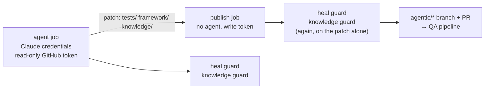

# CI/CD

## QA pipeline

[`.github/workflows/ci.yml`](../.github/workflows/ci.yml) runs on every push to `main`, every pull request and
nightly.

| Job                                  | Runs                                                                                                                                                         |
| ------------------------------------ | ------------------------------------------------------------------------------------------------------------------------------------------------------------ |
| lint · types · format · unit         | ESLint, `tsc`, Prettier, the QA-engine unit tests, recipe catalog and test-case setups, vault frontmatter                                                    |
| heal guard · knowledge guard         | on pull requests: test changes follow documented behaviour, vault changes follow the curation ledger (blocking on `agentic/*` branches, a report for humans) |
| hybrid RAG · local / neo4j           | index build, retrieval eval (golden, dev, held-out), knowledge-gate tests                                                                                    |
| change impact                        | on pull requests: the impacted tests' `--grep`                                                                                                               |
| api · chromium ×2 · firefox · webkit | the Playwright suite in the Playwright image (impact-selected on pull requests)                                                                              |
| staging · smoke, live · read-only    | each environment's stand-in: `@smoke` on staging, `@readonly` on live                                                                                        |
| seeded-defect detection              | a clean baseline, then every seeded defect must turn a test tagged with its rule red                                                                         |
| traceability · release gate          | merged report → traceability → Go/No-Go → defect board → [GitHub Pages](https://hoanglan9569.github.io/agentic-qa/)                                          |
| release decision                     | on a push to `main`, after the report is published: a NO-GO (or no decision) fails the pipeline                                                              |

## Agentic QA

[`.github/workflows/agentic-qa.yml`](../.github/workflows/agentic-qa.yml) runs a workflow headless with the Claude
Agent SDK: on demand (any workflow), on a pull request labelled `agentic-qa` (a test plan, then regression, with the
summary posted on the pull request), and on every merged pull request (`learn`).

- The **agent job** holds the Claude credentials but only a read-only GitHub token; the tool-policy hook limits its
  writes to `tests/`, `framework/` and `out/` (the vault through the knowledge MCP). What it wrote leaves as a patch.
- The **publish job** runs no agent. It applies only `tests/`, `framework/`, `knowledge/` and the learned probes from
  the patch, runs both guards on the patch itself, then pushes `agentic/<workflow>-<run>` and opens the pull request.
- With an `AGENT_PR_TOKEN` secret (fine-grained PAT or GitHub App token) the pull request triggers CI itself;
  without one, the publish job dispatches the QA pipeline on the branch.

## Azure Pipelines

[`azure-pipelines.yml`](../azure-pipelines.yml) is the same on Azure DevOps (`.azure/setup.yml` installs the
tools): checks, parallel regression published to Test Runs, the gate, and the Agent SDK regression stage. The
GitHub workflows are the ones run on every push.

## Secrets

| Secret                                           | Used for                                                   |
| ------------------------------------------------ | ---------------------------------------------------------- |
| `STRING_HEX_SHOPLITE`                            | decrypts the saved accounts in `env/` (demo key in README) |
| `ANTHROPIC_API_KEY` or `CLAUDE_CODE_OAUTH_TOKEN` | the agent job; without one it explains and skips           |
| `AGENT_PR_TOKEN` (optional)                      | agent pull requests that trigger CI themselves             |
| `LANGSMITH_API_KEY` (optional)                   | retrieval experiments logged to LangSmith                  |
