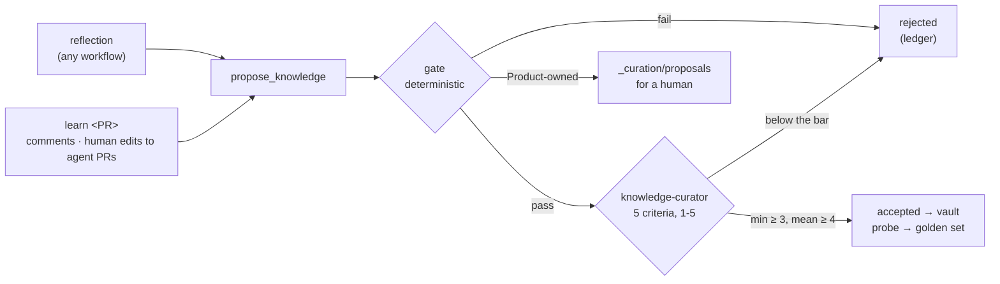

# Knowledge: the vault, Hybrid RAG and the self-improving loop

`knowledge/` holds the business knowledge as Markdown with frontmatter and `[[links]]`: feature cards, business
rules, work-item cards, defects, manual test cases, review learnings and the generated setup catalog
([vault README](../knowledge/README.md)). Agents read it through the **knowledge MCP**; only the MCP writes it.

## Hybrid RAG

`rag/` (Python, uv) indexes the vault two ways:

- **Vector:** chunks by section, embedded locally (all-MiniLM-L6-v2) into **ChromaDB**.
- **Knowledge graph:** documents, code files, endpoints and spec files, linked by typed edges: `GOVERNED_BY`,
  `PART_OF`, `COVERS`, `IMPLEMENTED_IN`, `EXPOSES`, `VERIFIES` (from test tags) and `LINKS_TO`. It lives in **Neo4j**
  when `NEO4J_URI` is set, otherwise in memory.
- **Hybrid search:** vector hits, graph neighbours of the ids the query names and of the top hits, and query intent,
  fused with reciprocal-rank fusion. Documents that restate others (test cases, the setup catalog) rank below their
  sources unless the question asks for them.

### Evaluation

`bun run rag:eval` scores the three modes on three question sets. CI fails when, on the tuning set, hybrid's hit@5
drops below 0.9, its MRR below 0.8 or below vector-only's, or when held-out hybrid hit@5 drops below 0.85. Dev and
held-out MRR are reported, not enforced:

| Set                                   | Used for                                              | Questions |
| ------------------------------------- | ----------------------------------------------------- | --------- |
| `golden.yaml` + `golden.learned.yaml` | the ranking priors were tuned here; learned probes    | 28        |
| `golden.dev.yaml`                     | choosing the next ranking change                      | 24        |
| `golden.holdout.yaml`                 | never tuned or chosen on, so it's the number to trust | 59        |

| Mode   | Golden: hit@1 · hit@5 · MRR | Dev: hit@1 · hit@5 · MRR  | Held out: hit@1 · hit@5 · MRR |
| ------ | --------------------------- | ------------------------- | ----------------------------- |
| vector | 0.679 · 1.0 · 0.805         | **0.833** · 0.875 · 0.847 | 0.746 · 0.983 · 0.853         |
| graph  | 0.393 · 0.607 · 0.500       | 0.417 · 0.667 · 0.521     | 0.322 · 0.576 · 0.426         |
| hybrid | **0.714 · 1.0 · 0.851**     | 0.792 · **0.958 · 0.858** | **0.763 · 0.983 · 0.860**     |

On questions it was never tuned on, hybrid is only one question ahead of vector-only (hit@1 0.763 vs 0.746), which is
within noise at this size, and the graph's share of it is small: with every graph edge removed, held-out MRR moves
from 0.860 to 0.856 (hit@1 back to 0.746) and dev doesn't move (ablation run on 2026-10-18). An id the query names is
found by a regex (`ID` in `rag/hybrid.py`), not by the graph. The graph earns its place in `related()` walks (a
feature → its rules, code, specs, defects) and in the related documents each search result lists.
An earlier 14-question held-out set had hybrid clearly behind (0.738 vs 0.845 MRR). At that size one question
moves MRR by ~0.07, so the set was grown to 59.

With `LANGSMITH_API_KEY` set the run is logged to **LangSmith** as an experiment, and `--answers` adds answer
quality: Claude answers from the retrieved context only, and an LLM judge scores faithfulness.

## Knowledge MCP server

`rag/server.py` exposes `search_knowledge`, `get_document`, `related`, `list_documents`, `upsert_document` (test
cases and defects), `propose_knowledge`, `commit_knowledge` and `audit_knowledge`. Every write re-indexes in the
same call. `upsert_document` writes a test case or defect only at a path of its own: in its folder (checked on the
resolved path), named after its id, never over another document.

### Shared MCP endpoint

The same server runs over HTTP for other teams' AI tools, **read-only** by default (`--writable` to opt in): vault
changes go through the repo's agents and pull requests.

```bash
docker compose up --build        # MCP at http://localhost:8765/mcp, with Neo4j

# Azure Container Apps
az acr build -r <acr> -t knowledge-mcp:1 -f rag/Dockerfile .
az containerapp create -n knowledge-mcp -g <rg> --environment <env> \
  --image <acr>.azurecr.io/knowledge-mcp:1 --registry-server <acr>.azurecr.io \
  --ingress external --target-port 8765 --secrets neo4j-password=<pw> \
  --env-vars NEO4J_URI=<bolt-uri> NEO4J_PASSWORD=secretref:neo4j-password MCP_ALLOWED_HOSTS=<app-fqdn>
```

The endpoint has no auth of its own: keep it on an internal network, or put Container Apps authentication (Entra
ID) in front of it.

## Self-improving knowledge

Every workflow ends with a **reflection** (`.claude/rules/self-improve.md`): reviewer revisions, fix-and-rerun
rounds, facts the vault lacked, tool pitfalls and human corrections become at most three candidate lessons.



| Gate check | Fails when                                                                                                     |
| ---------- | -------------------------------------------------------------------------------------------------------------- |
| shape      | no probe question, over 1,500 characters, or it reads as a run log ("this run", "I tried") instead of guidance |
| evidence   | none, or a cited file does not exist                                                                           |
| links      | a `[[link]]` points at nothing                                                                                 |
| scope      | `applies_to` matches no file                                                                                   |
| ownership  | rules, cards, the overview and feature behaviour belong to Product → filed for a human, never written          |
| novelty    | an `add` is ≥ 0.65 cosine-similar to an existing document → must be an `update` of it                          |
| retrieval  | on a throwaway index, a golden question loses its answer, MRR drops > 0.02, or the probe misses the document   |

- **Independent judge.** `knowledge-curator` is a different agent from the proposer and scores **grounded,
  reusable, actionable, scoped, consistent**; `commit_knowledge` enforces the bar, so a failed gate can't be
  overruled, and only the curator may call it.
- **Provenance.** Learnings are `provisional` until human evidence or a second independent source (`support: 2`)
  makes them `established`. Accepted probes join `rag/golden.learned.yaml`, so a later change can't make learned
  knowledge unfindable.
- **Ledger.** Every decision is a line in `knowledge/_curation/ledger.jsonl`, with the sha of the exact file it
  accepted.
- **Knowledge guard.** `qa/knowledge-guard.ts` checks a diff against the ledger: a learning or feature map changes
  only as an accepted line of the same diff states it (doc id + sha), the ledger only grows, Product's documents
  never change in an agent's patch. It runs in the agent's job, in the job that publishes its patch, and in CI.
- **Audit.** `learn --audit` (`bun run kb:audit`) re-validates what's there: stale scopes, unconfirmed lessons after
  60 days, near-duplicates. On every merged PR, CI runs `learn <PR>` and opens a PR with what was accepted.
